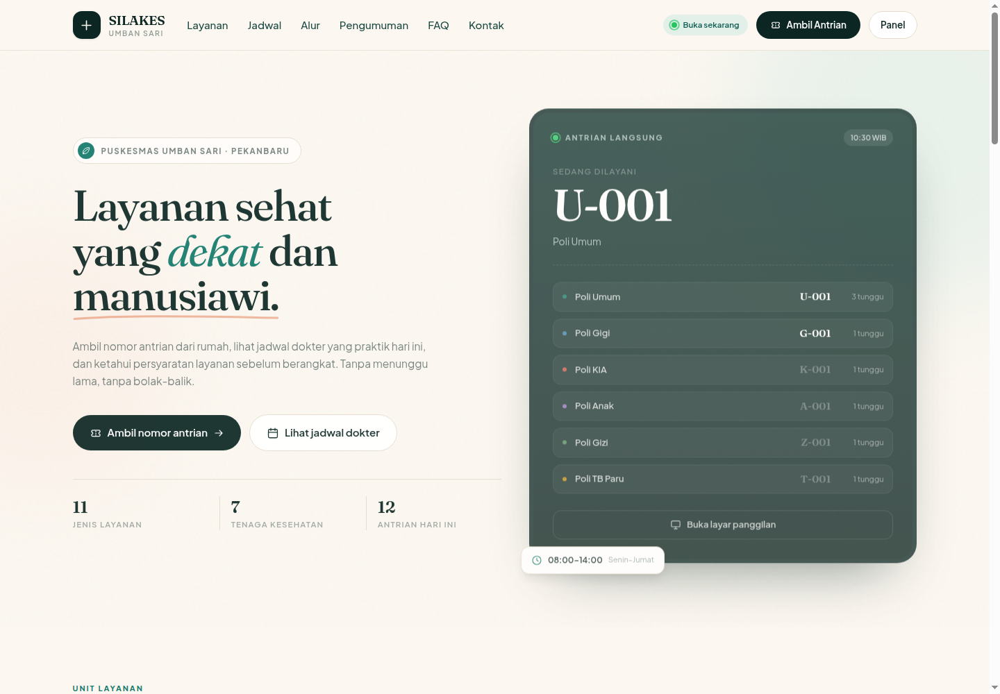
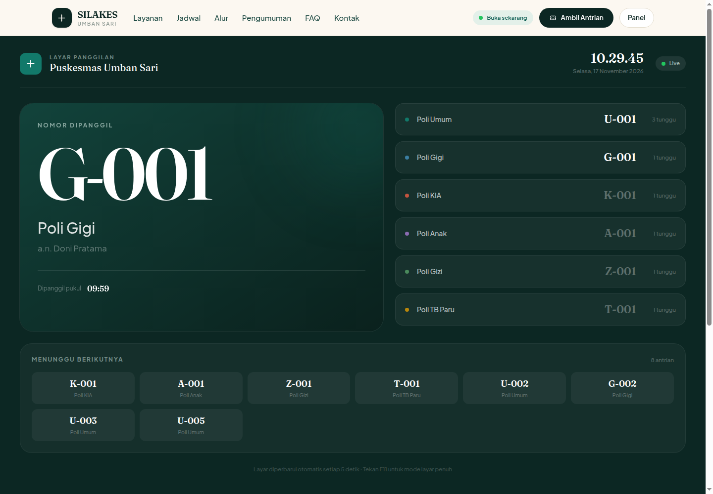
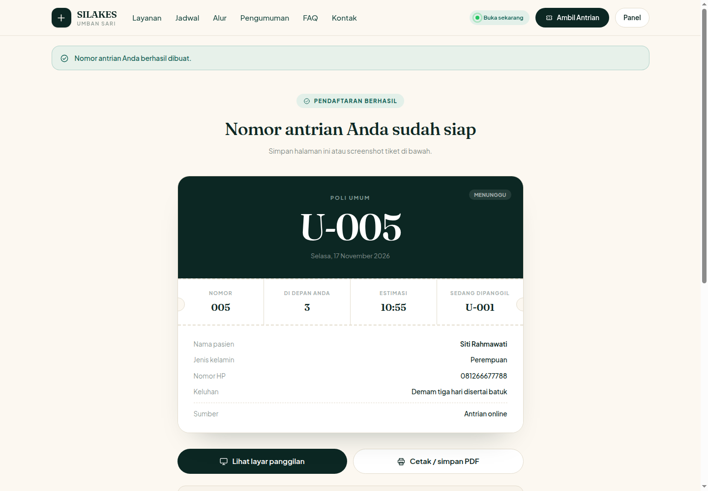

# SILAKES — Sistem Informasi Layanan Kesehatan Puskesmas Umban Sari

Aplikasi web layanan **Puskesmas Umban Sari, Pekanbaru**, dikembangkan dari laporan
Capstone Project Kelompok 4. Terdiri dari situs publik untuk warga dan panel pengelola
untuk petugas puskesmas.

Pembeda utama: **antrian online** (ambil nomor dari rumah, tanpa datang lebih awal) dan
**layar panggilan real-time** untuk ruang tunggu.



## Fitur

**Situs publik**

- Beranda: jam operasional otomatis (buka/tutup), layanan unggulan, jadwal hari ini,
  status antrian langsung per poli
- Layanan: daftar + detail (persyaratan, durasi, alur)
- Jadwal praktik per hari, dikelompokkan per poli
- Alur pelayanan, pengumuman, FAQ, kontak
- **Antrian online**: pilih poli → isi data → tiket digital berisi kode, nomor, estimasi
  jam dilayani, dan sisa antrian di depan
- **Layar panggilan** (`/antrian/layar`): nomor sedang dipanggil, status per poli, daftar
  tunggu berikutnya — auto-refresh 5 detik

**Panel pengelola** (`/panel`, login)

- Dasbor: ringkasan hari ini, tren 7 hari, panggil berikutnya
- Antrian: daftar per tanggal, aksi panggil / selesai / lewat / batal, pendaftaran loket
- CRUD poli, layanan, tenaga kesehatan, jadwal praktik, pengumuman, FAQ
- Pengaturan identitas puskesmas, jam operasional, kontak
- Pengguna & log aktivitas (khusus admin)




## Stack

| Bagian | Teknologi |
|---|---|
| Backend | Laravel 12, PHP 8.4 |
| Database | MariaDB 11.4 (MySQL-compatible) |
| Frontend | Blade, Tailwind CSS 4, Alpine.js 3, Vite 7 |
| Auth | Session guard Laravel, rate limit 5 percobaan/menit |

## Menjalankan

```bash
composer install
npm install
npm run build

cp .env.example .env      # sesuaikan koneksi DB
php artisan key:generate
php artisan migrate --seed
php artisan serve
```

Buka `http://127.0.0.1:8000`.

### Akun demo

| Peran | Email | Password |
|---|---|---|
| Admin | `admin@silakes.test` | `admin12345` |
| Petugas | `petugas@silakes.test` | `petugas12345` |

> Ganti password ini sebelum dipakai di lingkungan nyata.

## Aturan data penting

- Kode antrian memakai huruf unik per poli: `U`mum, `G`igi, `K`IA, `A`nak, Gi`z`i, `T`B Paru.
  Nomor dihitung per poli per tanggal.
- Antrian online ditolak bila poli tidak punya jadwal aktif hari itu; kartu poli yang tutup
  ditandai "Tidak praktik hari ini" dan tidak bisa dipilih.
- Estimasi jam dilayani = jam panggilan terakhir + (selisih nomor × durasi layanan), tidak
  pernah menampilkan jam yang sudah lewat.
- Zona waktu `Asia/Jakarta`, locale fallback `id`.

## Batasan produk

Sesuai laporan: aplikasi **tidak** menegakkan diagnosis, **tidak** menggantikan konsultasi
tenaga kesehatan, dan **tidak** menyimpan rekam medis elektronik. Data yang disimpan
terbatas pada informasi layanan dan administrasi kunjungan.

## Dokumentasi

- [`docs/PRD.md`](docs/PRD.md) — kebutuhan produk, persona, alur, kriteria terima
- [`docs/PANDUAN.md`](docs/PANDUAN.md) — panduan teknis & rute
- [`GLOSSARY.md`](GLOSSARY.md) — istilah domain
- [`docs/adr/0001-stack-dan-antrian-per-poli.md`](docs/adr/0001-stack-dan-antrian-per-poli.md) — keputusan arsitektur

## Lisensi

Kode aplikasi ini dibuat untuk keperluan akademik (Capstone Project Kelompok 4).
Laravel sendiri berlisensi MIT.
